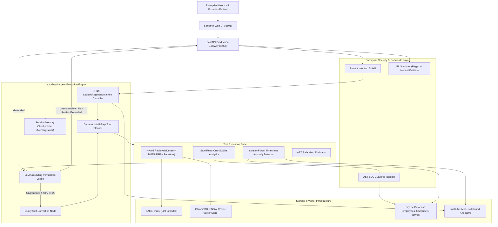
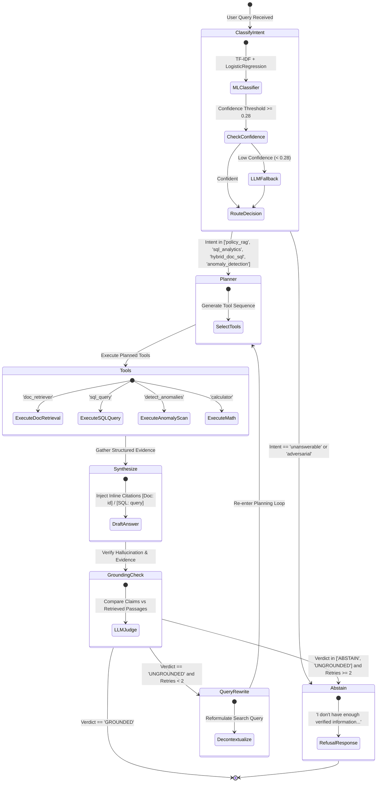
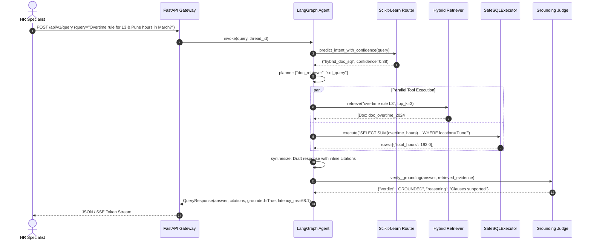
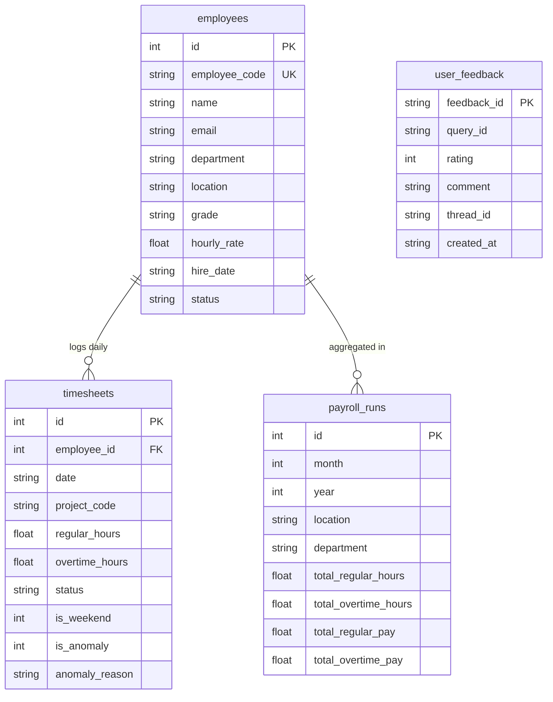
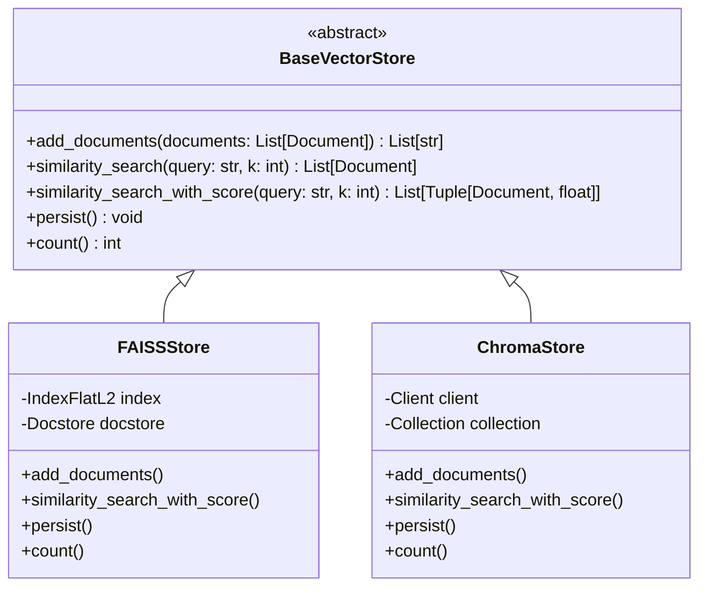
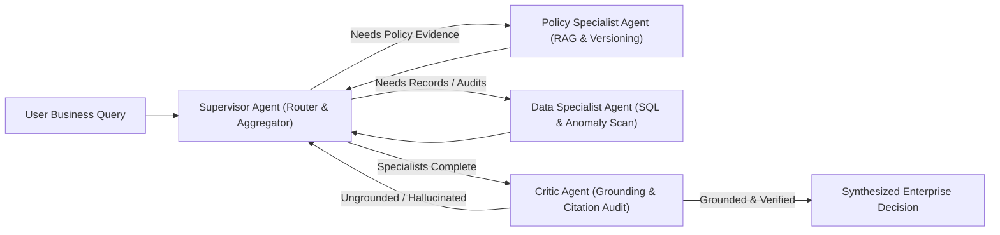

# DecisionIQ: System Architecture Specification

DecisionIQ is an enterprise-grade **Agentic RAG Assistant** designed for complex data-to-decision workflows in human resources, timesheet auditing, and payroll operations. It unifies unstructured policy documentation, structured relational business records, and unsupervised anomaly detection under a verified, self-correcting StateGraph.

---

## 1. High-Level System Architecture

---

## 2. LangGraph StateGraph Node Lifecycle & Conditional Edges

---

## 3. End-to-End Query Execution Sequence Diagram

---

## 4. Relational Database Schema (`decisioniq.db`)

---

## 5. Dual Vector Store Abstraction Architecture

---

## 6. Multi-Agent Supervisor Variant Architecture

